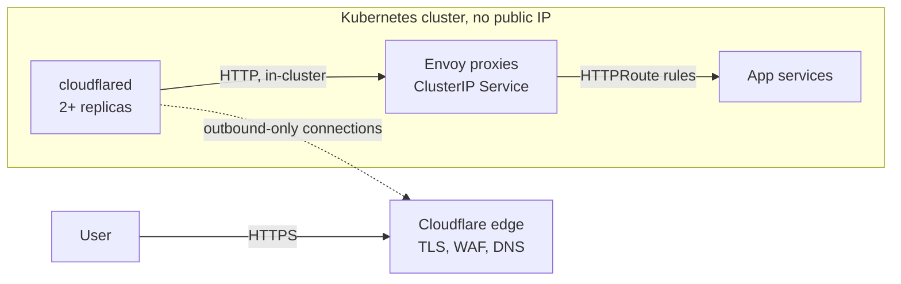

# envoy-gateway-cloudflare-tunnel

[](https://github.com/asmarun/envoy-gateway-cloudflare-tunnel/actions/workflows/ci.yaml)

A runnable lab for putting a Kubernetes cluster on the internet **without a public IP or cloud load balancer**: Cloudflare DNS and Tunnel at the edge, [Envoy Gateway](https://gateway.envoyproxy.io) (Kubernetes Gateway API) inside the cluster. It documents the pattern as an alternative to Azure Application Gateway + AGIC, including the migration path and the trade-offs.

> A personal learning project. The patterns are generic and written from scratch; nothing here comes from any employer's code or environment.

## Why

A cloud L7 gateway in front of Kubernetes carries costs that scale with the number of gateways and environments, needs a public entry point, and adds a controller (AGIC) between your manifests and the thing serving traffic. This lab shows a different shape:



| | Application Gateway + AGIC | Cloudflare Tunnel + Envoy Gateway |
|---|---|---|
| Inbound path | Public IP and load balancer | None; cluster connects outbound |
| Routing config | Ingress + AGIC annotations, pushed to the gateway via Azure | Gateway API objects, programmed in-cluster |
| WAF | Azure WAF | Cloudflare WAF (different rules; re-validate) |
| TLS | At the gateway | At the Cloudflare edge (end-to-end TLS optional) |
| Cost shape | Fixed + capacity charges per gateway | Envoy/cloudflared compute + Cloudflare plan; see [cost model](docs/cost-model.md) |
| You operate | Little (managed) | Envoy Gateway and cloudflared (see [runbook](docs/operations.md)) |

It is not a free lunch: Cloudflare becomes a hard dependency in the request path. Read [trade-offs](docs/trade-offs.md) before adopting it.

## What is in here

| Path | What |
|---|---|
| `deploy/helm/` | Envoy Gateway control-plane values (HA) |
| `deploy/envoy-gateway/` | Namespaces, `Gateway`, `EnvoyProxy` (ClusterIP, fixed Service name, HPA, PDB, spread), client-IP policy |
| `deploy/cloudflared/` | Production-shaped connector (HA Deployment, PDB, hardened), quick-tunnel for demos, NetworkPolicy |
| `deploy/sample-app/` | A demo app, `HTTPRoute`, and `BackendTrafficPolicy` (timeout, health check, rate limit) |
| `terraform/cloudflare/` | `tunnel` and `tunnel-routes` modules plus an example (tunnel, route list, DNS) |
| `scripts/` | Smoke test and NetworkPolicy test |
| `docs/` | Architecture, AGIC migration guide, trade-offs, cost model, runbook |

## Quickstart A: no account, no domain (about 10 minutes)

Needs `docker`, `kubectl`, `helm`, and either `minikube` or `kind`.

```bash
make cluster-minikube      # Kubernetes with Calico so NetworkPolicy is enforced
make up                    # Envoy Gateway, Gateway, policies, sample app
make tunnel-quick          # cloudflared with a random trycloudflare.com URL
make tunnel-url            # prints the URL; open it in a browser
make netpol                # only cloudflared may reach Envoy
make smoke                 # header and fail-closed checks from inside the cluster
make netpol-test           # a non-cloudflared pod is blocked
make resilience-test       # delete an Envoy pod mid-traffic through the tunnel
make clean-cluster         # tear it all down
```

The quick tunnel is for demos only: no uptime guarantee, random hostname.

## Quickstart B: your own domain, named tunnel

Needs a Cloudflare account, a domain on Cloudflare, and an API token with **Account > Cloudflare Tunnel > Edit** and **Zone > DNS > Edit**.

```bash
cd terraform/cloudflare/example
cp terraform.tfvars.example terraform.tfvars     # set account id, zone id, hostnames
export CLOUDFLARE_API_TOKEN=...
terraform init && terraform apply

cd ../../..
export TUNNEL_TOKEN=$(terraform -chdir=terraform/cloudflare/example output -raw tunnel_token)
make up netpol tunnel-named
```

Then point an `HTTPRoute` at your hostname (the sample uses no hostname so it matches any).

## Design decisions worth reading

Each is explained in [docs/architecture.md](docs/architecture.md):

1. **ClusterIP, no load balancer.** The tunnel is the only way in.
2. **A fixed Envoy Service name**, so the tunnel's origin URL survives Gateway re-creation.
3. **One Terraform state owns a tunnel's entire route list.** Cloudflare stores routes as one object; parallel applies from per-environment states silently overwrite each other.
4. **cloudflared as a fixed-replica Deployment**, with hard hostname spreading, a PDB and zero-unavailable rollouts.
5. **`CF-Connecting-IP` trusted fail-closed, protected by a NetworkPolicy.** The two controls only work together.
6. **Envoy scales up fast and down slowly**, to protect long-lived connections.

## Migrating from Application Gateway + AGIC

[docs/migration-from-agic.md](docs/migration-from-agic.md) covers the annotation-to-Gateway-API mapping, running both side by side, cutover, rollback and decommission.

## Verification status

Run on 2026-10-18 on a local minikube cluster (Kubernetes 1.33.1, Calico), Envoy Gateway v1.9.2, cloudflared 2026.10.1.

| Check | Result |
|---|---|
| Manifests validate against Kubernetes, Gateway API and Envoy Gateway schemas (`kubeconform`, strict) | pass |
| `yamllint` | pass |
| `terraform fmt` and `terraform validate` (Cloudflare provider 5.28.0) | pass |
| Gateway programmed; HTTPRoute, ClientTrafficPolicy and BackendTrafficPolicy accepted | pass |
| Envoy Service is `ClusterIP` with the fixed name `edge-envoy`; no external IP | pass |
| `make smoke`: request with `CF-Connecting-IP` returns 200; without it returns 403 (fail-closed) | pass |
| `make netpol-test`: a pod outside cloudflared reaches Envoy before the policy (control) and is blocked after | pass |
| Public request through a quick tunnel (`trycloudflare.com`) reaches the app, which receives `Cf-Connecting-Ip` | pass |
| `make resilience-test`: 80 of 80 requests succeeded while an Envoy pod was deleted (one client, ~4 req/s) | pass, an observation not a guarantee |
| Envoy HPA reads CPU from metrics-server | pass |
| CI on GitHub Actions: lint, schema validation, Terraform, gitleaks, and the Gateway/client-IP smoke test on a kind cluster | pass |
| `named-tunnel.yaml` accepted by the API server (`--dry-run=server`) | pass |
| Terraform `apply` and a named tunnel against a real Cloudflare account | **not run** |
| Multi-region failover (one tunnel per cluster + Cloudflare load balancing) | **not run**; described in [architecture](docs/architecture.md), not simulated |

The HPA needs `metrics-server`; `make cluster-minikube` enables it. CI repeats the lint checks and the Gateway/smoke steps on a kind cluster.

Versions: Envoy Gateway v1.9.2, cloudflared 2026.10.1, podinfo 6.15.0, Cloudflare Terraform provider 5.x.

## License

MIT
