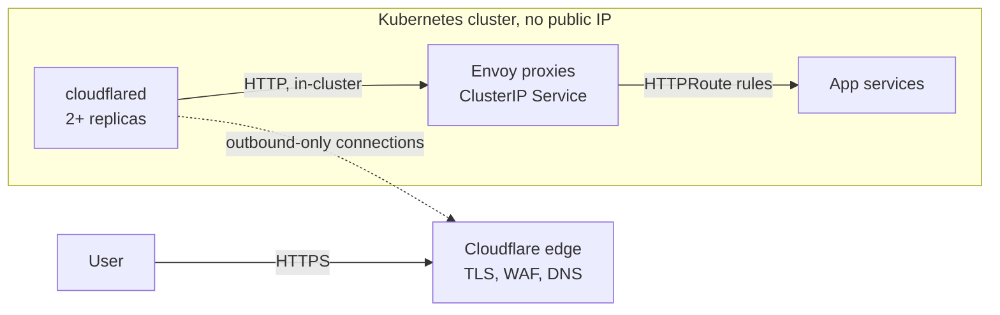

# Architecture

## Request path

1. The user resolves a proxied DNS record (a `CNAME` to `<tunnel-id>.cfargotunnel.com`) and reaches the Cloudflare edge, where TLS terminates and edge protections (WAF, rate limiting, access policies) apply.
2. Cloudflare forwards the request over a tunnel that **cloudflared** opened *outbound* from the cluster. Nothing connects in.
3. cloudflared proxies to the in-cluster **Envoy** Service using the origin URL from the tunnel's route list.
4. Envoy matches an **HTTPRoute** (Gateway API) and sends the request to the backend Service.

## Components and who owns what

| Component | Where | Owns |
|---|---|---|
| DNS record | Cloudflare | Hostname → tunnel mapping |
| Tunnel + token | Cloudflare (Terraform `tunnel` module) | Identity of the tunnel |
| Route list (hostname → origin URL) | Cloudflare (Terraform `tunnel-routes` module) | Which hostnames this tunnel serves |
| cloudflared | `cloudflared` namespace | Outbound connections, failover between replicas |
| Envoy Gateway controller | `envoy-gateway-system` | Reconciles Gateway API objects into Envoy config |
| Envoy proxies (data plane) | `envoy-gateway-system` | Routing, timeouts, rate limits, client-IP handling |
| Gateway, EnvoyProxy, policies | `edge` namespace | Listener and data-plane settings |
| HTTPRoutes | App namespaces | Application routing, owned by app teams |

The split in the last row matters: platform owns the Gateway, app teams own their HTTPRoutes. The Gateway only accepts routes from namespaces labelled `gateway-access: edge`.

## Decisions and why

### 1. ClusterIP, no load balancer
`envoyService.type: ClusterIP` means the cloud never provisions a public IP or load balancer for ingress. The attack surface is the tunnel, not an open port. The cost of that: you depend on the tunnel being up (see HA below).

### 2. A fixed Service name for Envoy
By default Envoy Gateway names its Service `envoy-<namespace>-<gateway>-<hash>`. The tunnel's route list has to contain that URL, so a recreated Gateway would silently break routing. Setting `envoyService.name: edge-envoy` makes the origin URL a constant: `http://edge-envoy.envoy-gateway-system.svc.cluster.local:80`.

### 3. One state owns a tunnel's whole route list
Cloudflare stores a tunnel's published routes as a **single ordered ingress list**, and every update replaces it. If `dev`, `qa` and `uat` each managed their own hostname from separate Terraform states, the last apply would delete the others' routes.

The fix is an ownership boundary, not a technique: one Terraform state per tunnel owns the complete `published_routes` list (the `tunnel-routes` module), and it lives next to the tunnel, not inside each environment. A shared tunnel per cluster (or per cluster slice) publishing many hostnames is the natural unit. The module's validation rejects duplicate hostnames so two entries can't collapse into one DNS record.

### 4. Catch-all rule is mandatory
Cloudflare requires the last ingress rule to have no hostname. The module always appends `http_status:404`, so unknown hostnames get a clean 404 instead of a validation error.

### 5. cloudflared as a Deployment, not a DaemonSet
Connector count is a decision (2 for non-production, 3 for production is a sensible start), not a function of node count. Replicas are also the failover: each opens its own outbound connections. Hard hostname spreading, best-effort zone spreading, a PDB and `maxUnavailable: 0` rollouts keep at least one connector alive through node drains and upgrades.

### 6. Trust CF-Connecting-IP only because nothing else can reach Envoy
`ClientTrafficPolicy` reads the client IP from `CF-Connecting-IP` with `failClosed: true`, so a request without it is rejected. That header is trivially forgeable by anything that can reach Envoy directly, so the `NetworkPolicy` limits Envoy's listener to cloudflared pods. The two controls only make sense together.

### 7. Scale Envoy up fast, down slowly
An HPA with a long scale-down stabilisation window (10 minutes, one pod per minute) avoids dropping long-lived connections when load briefly dips. Anti-affinity and topology spread keep replicas off the same node.

## High availability

| Failure | Behaviour |
|---|---|
| One cloudflared pod or node | Other replicas keep serving; the PDB prevents voluntary eviction of the last one |
| One Envoy pod | Remaining replicas serve; HPA/PDB protect during drains |
| Whole cluster or region | Not covered by one cluster. Run one tunnel per cluster and put Cloudflare load balancing with health checks in front, steering to the healthy cluster. Described, not simulated, in this lab |
| Cloudflare itself | A hard dependency. See [trade-offs](trade-offs.md) |

## Ports and egress

- Envoy listener: Service port 80 maps to container port **10080** (Envoy Gateway's default for ports below 1024). NetworkPolicy matches the container port.
- Envoy metrics: 19001. cloudflared metrics and readiness: 2000.
- cloudflared needs **outbound** access to Cloudflare on port 7844 (TCP and UDP) plus DNS. If you restrict egress, allow those.
